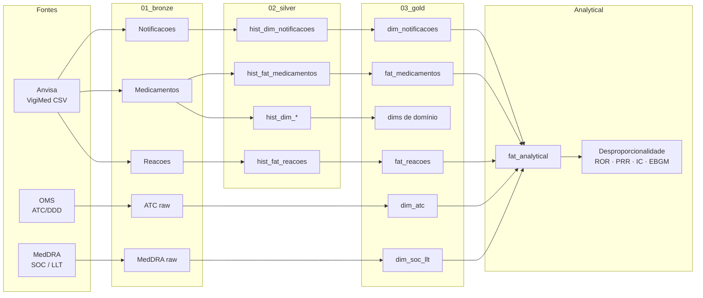
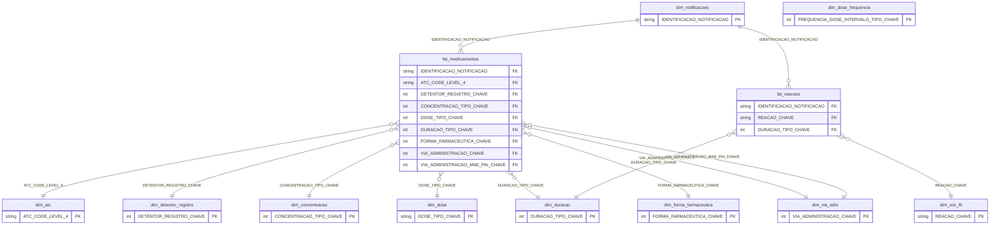

# VigiMed

Projeto para centralizar a ingestão, processamento e análise dos dados do [VigiMed](https://www.gov.br/anvisa/pt-br/assuntos/fiscalizacao-e-monitoramento/notificacoes/vigimed) (Anvisa), enriquecidos com terminologias [ATC](https://www.who.int/tools/atc-ddd-toolkit/atc-classification) (OMS) e [MedDRA](https://www.meddra.org/how-to-use).

Os datasets públicos do VigiMed são atualizados semanalmente e disponibilizados em CSV:

- `VigiMed_Notificacoes.csv`
- `VigiMed_Medicamentos.csv`
- `VigiMed_Reacoes.csv`

Fonte dos arquivos brutos: [dados abertos da Anvisa](https://dados.anvisa.gov.br/dados/).

Dicionário de dados (camada gold): [`docs/data_dictionary.md`](docs/data_dictionary.md).

### Pipeline ELT

Fluxo Bronze → Silver → Gold, com enriquecimento ATC/MedDRA e consumo analítico (desproporcionalidade).



Notebooks em [`src/etl/`](src/etl/) (ingestão/transformação) e consumo analítico em [`src/analytical/`](src/analytical/) + [`eda/disproportionality_analysis/`](eda/disproportionality_analysis/).

### ERD — camada gold (chaves)

Esquema em estrela / fact constellation: `dim_notificacoes` liga as facts `fat_medicamentos` e `fat_reacoes`; dimensões de medicamento e MedDRA/ATC completam o modelo.



> Diagrama completo (todas as colunas): [draw.io](https://viewer.diagrams.net/?tags=%7B%7D&lightbox=1&highlight=0000ff&edit=_blank&layers=1&nav=1&dark=auto#G1z0v-POQDdwkInzBVEe6cLE4_uBEn7GZD#%7B%22pageId%22%3A%221UQrTR_ZhEASL8xhWuEK%22%7D).

## Créditos e fontes de dados

Este projeto depende de dados e terminologias disponibilizados publicamente. Atribuímos crédito às instituições responsáveis:

| Fonte | O que usamos | Link |
| --- | --- | --- |
| **Anvisa — VigiMed** | Notificações espontâneas de suspeitas de eventos adversos a medicamentos no Brasil | [Página VigiMed](https://www.gov.br/anvisa/pt-br/assuntos/fiscalizacao-e-monitoramento/notificacoes/vigimed) · [Dados abertos](https://dados.anvisa.gov.br/dados/) |
| **OMS — ATC/DDD** | Classificação Anatômica Terapêutica Química (níveis 1–5) para agrupamento de medicamentos | [ATC Classification](https://www.who.int/tools/atc-ddd-toolkit/atc-classification) |
| **MedDRA** | Terminologia médica para reações adversas (ex.: SOC, PT, LLT) | [How to use MedDRA](https://www.meddra.org/how-to-use) |

O uso de MedDRA está sujeito aos termos e condições da MSSO/ICH. Consulte a documentação oficial antes de redistribuir ou publicar derivados que incluam a terminologia.

## Dataset Gold (Dataverse) e publicações

A versão **gold** processada deste projeto foi publicada no Harvard Dataverse:

- **Dataset:** [doi:10.7910/DVN/DRWDMU](https://dataverse.harvard.edu/dataset.xhtml?persistentId=doi:10.7910/DVN/DRWDMU)

Esse material já embasou estudos acadêmicos, incluindo:

- a **dissertação** da Ana Carolina Jacoby ([registro / divulgação](https://www.instagram.com/p/DYfmyebyNGN/));
- a **revisão de escopo** sobre métodos de data mining em farmacovigilância, de Ana Carolina Jacoby e Mell Amisa Matsuda (com Carine Raquel Blatt e Sílvio César Cazella): [*Data mining methods, tasks, and algorithms for adverse drug reaction analysis in pharmacovigilance: A scoping review*](https://pubmed.ncbi.nlm.nih.gov/42378892/) (*Int J Med Inform*, 2026; PMID: 42378892; DOI: [10.1016/j.ijmedinf.2026.106554](https://doi.org/10.1016/j.ijmedinf.2026.106554)).

## Setup

Requisitos: Python 3.9+ e `pip`.

### 1. Clone e ambiente virtual

```bash
git clone https://github.com/mlab-inf-ufrgs/vigimed.git
cd vigimed

python3 -m venv .venv
source .venv/bin/activate   # Windows: .venv\Scripts\activate
```

### 2. Instalar dependências

As libs do projeto estão em [`src/requirements.txt`](src/requirements.txt) (pandas, DuckDB, Jupyter, visualização, etc.):

```bash
pip install -r src/requirements.txt
```

Alternativa via notebook: abra [`src/libs.ipynb`](src/libs.ipynb) e execute a célula

```python
%pip install -r requirements.txt
```

(o notebook assume o working directory em `src/`).

### 3. Verificar a instalação

No terminal, com o `.venv` ativado:

```bash
python - <<'PY'
import pandas as pd
import pyarrow
import duckdb
import rapidfuzz
import scipy
import matplotlib
import seaborn
import plotly

print("OK — dependências principais importadas com sucesso")
print(f"  pandas {pd.__version__}")
print(f"  duckdb {duckdb.__version__}")
PY
```

Se aparecer `OK — dependências principais importadas com sucesso`, o ambiente está pronto.

Para usar os notebooks no Jupyter/VS Code, registre o kernel do venv:

```bash
python -m ipykernel install --user --name=vigimed --display-name="Python (vigimed)"
```

## Estrutura do repositório

```bash
vigimed/
├── config/                 # Bootstrap (sys.path / project root)
├── data/                   # Camadas Bronze → Silver → Gold
│   ├── 01_bronze/
│   ├── 02_silver/
│   └── 03_gold/
├── docs/                   # Documentação (ex.: data_dictionary.md)
├── eda/                    # Exploração e análise de desproporcionalidade
├── src/
│   ├── analytical/         # Build do DF analítico e métricas (stubs)
│   ├── etl/                # Notebooks ELT/ETL (medicamentos, notificações, reações)
│   ├── utils/              # Funções auxiliares de normalização e merge
│   ├── libs.ipynb          # Instalação das libs via notebook
│   └── requirements.txt    # Dependências Python
├── tests/                  # Validações e checks da silver/gold
│   ├── validacao_medicamentos/
│   ├── validacao_notificacao/
│   └── validacao_reacoes/
```

## Licença de uso dos dados

Os dados do VigiMed são publicados pela Anvisa em dados abertos. ATC e MedDRA possuem políticas próprias de uso e redistribuição — consulte os links na seção de créditos antes de republicar conteúdo derivado.
