# VigiMed

Project for ingesting, processing, and analyzing data from **VigiMed**, the Brazilian Health Regulatory Agency (ANVISA) pharmacovigilance system, enriched with the **ATC** (WHO) and **MedDRA** medical terminologies.

🇺🇸 **English** | [🇧🇷 Português](README.pt-BR.md)

**Getting started:** [`docs/start_here.md`](docs/start_here.md)

**Data Dictionary / Gold ERD:** [`docs/data_dictionary.md`](docs/data_dictionary.md) · [`docs/erd.md`](docs/erd.md)

---

ANVISA publishes three CSV files weekly through the Brazilian Open Data Portal, containing spontaneous reports of suspected adverse drug reactions submitted to the VigiMed system.

| File | Description |
|------|-------------|
| `VigiMed_Notificacoes.csv` | Individual Case Safety Reports (ICSRs): patient information, reporting dates, seriousness, outcomes, and reporter information. |
| `VigiMed_Medicamentos.csv` | Medications associated with each notification (WHO Drug, ATC classification, dose, route of administration, etc.). |
| `VigiMed_Reacoes.csv` | Reported adverse drug reactions associated with each notification. |

Within this repository, these source datasets are ingested into the **Bronze** layer and transformed into the **Gold** layer through an intermediate **Silver** layer, resulting in a dimensional data warehouse enriched with **ATC** and **MedDRA** terminologies.

---

## Project Background

The project originated from the master's research of **[Ana Carolina Jacoby](http://lattes.cnpq.br/6000861146264396)** at the **Federal University of Health Sciences of Porto Alegre (UFCSPA)**, under the supervision of **Prof. [Sílvio César Cazella](http://lattes.cnpq.br/9173977294178020)**.

It was subsequently expanded and consolidated through a collaboration with **[Silmara Gomes Barnabé](http://lattes.cnpq.br/4686076038752039)** (Federal University of Rio Grande do Sul – UFRGS) as part of the graduate course taught by **Prof. [Carla Maria Dal Sasso Freitas](http://lattes.cnpq.br/4093653182381054)** at the **[CIARS Research Center](https://www.ufrgs.br/ciars/)**, with additional support from **Prof. [Mariana Recamonde-Mendoza](http://lattes.cnpq.br/7829435808451741)**, Silmara Barnabé's academic advisor.

The published dataset is the result of a collaborative effort involving **[Ana Carolina Jacoby](http://lattes.cnpq.br/6000861146264396)**, **[Silmara Gomes Barnabé](http://lattes.cnpq.br/4686076038752039)**, **[Mell Amisa Matsuda](http://lattes.cnpq.br/4305262417608808)**, **Prof. [Carine Raquel Blatt](http://lattes.cnpq.br/4746842392238066)**, **Prof. [Sílvio César Cazella](http://lattes.cnpq.br/9173977294178020)**, and **Prof. [Mariana Recamonde-Mendoza](http://lattes.cnpq.br/7829435808451741)**.

# ELT Pipeline

The repository implements an **ELT pipeline** based on a **Bronze → Silver → Gold** architecture. During processing, the original VigiMed data are standardized, integrated with the **ATC** and **MedDRA** terminologies, and transformed into a dimensional data warehouse. The resulting analytical dataset is then used for disproportionality analyses and published through **Harvard Dataverse**.

**Mermaid overview:**

```mermaid
flowchart LR
    subgraph Sources
        A1[ANVISA<br/>VigiMed CSV]
        A2[WHO<br/>ATC/DDD]
        A3[MedDRA<br/>SOC / LLT]
    end

    subgraph Bronze["01_bronze"]
        B1[Notifications]
        B2[Medications]
        B3[Reactions]
        B4[Raw ATC]
        B5[Raw MedDRA]
    end

    subgraph Silver["02_silver"]
        S1[hist_dim_*]
        S2[hist_fat_medicamentos]
        S3[hist_fat_reacoes]
        S4[hist_dim_notificacoes]
    end

    subgraph Gold["03_gold"]
        G1[dim_notificacoes]
        G2[fat_medicamentos]
        G3[fat_reacoes]
        G4[dim_atc]
        G5[dim_soc_llt]
        G6[Domain dimensions]
    end

    subgraph Analytical
        AN[fat_analytical]
        DA[Disproportionality<br/>ROR · PRR · IC · EBGM]
    end

    A1 --> B1 & B2 & B3
    A2 --> B4
    A3 --> B5

    B1 --> S4
    B2 --> S2 & S1
    B3 --> S3
    B4 --> G4
    B5 --> G5

    S4 --> G1
    S2 --> G2
    S3 --> G3
    S1 --> G6

    G1 & G2 & G3 & G4 & G5 --> AN --> DA
```



For environment setup, repository organization, and usage instructions, see [`docs/start_here.md`](docs/start_here.md).

The complete Entity-Relationship Diagram (ERD), including all tables and columns in the Gold layer, is available in [`docs/erd.md`](docs/erd.md).


# Data Sources and Acknowledgments

This project relies on publicly available datasets and standardized medical terminologies. We gratefully acknowledge the organizations responsible for making these resources available.

| Source | Resource Used | Link |
|--------|---------------|------|
| **ANVISA — VigiMed** | Brazilian spontaneous reports of suspected adverse drug reactions | [VigiMed](https://www.gov.br/anvisa/pt-br/assuntos/fiscalizacao-e-monitoramento/notificacoes/vigimed) · [Open Data Portal](https://dados.anvisa.gov.br/dados/) |
| **WHO — ATC/DDD** | Anatomical Therapeutic Chemical (ATC) Classification System (levels 1–5) used for medication classification and aggregation | https://www.who.int/tools/atc-ddd-toolkit/atc-classification |
| **MedDRA** | International standardized medical terminology for coding adverse drug reactions (e.g., SOC, PT, LLT) | https://www.meddra.org/how-to-use |

Use of **MedDRA** is subject to the licensing terms and conditions established by the **MedDRA Maintenance and Support Services Organization (MSSO)** and the **International Council for Harmonisation (ICH)**. Please consult the official documentation before redistributing or publishing derivative works containing MedDRA terminology.

---

# Gold Dataset (Harvard Dataverse)

The processed **Gold** layer generated by this project is publicly available through **Harvard Dataverse**.

**Dataset**

- **Spontaneous Reporting of Adverse Drug Events in Brazil: VigiMed Dataset (2018–2025)**
- DOI: **10.7910/DVN/DRWDMU**
- Harvard Dataverse
- Current version: **V2**

https://doi.org/10.7910/DVN/DRWDMU

---

# Publications

The dataset has already supported multiple academic studies, including:

- **Master's dissertation** by **Ana Carolina Jacoby**.
- **Scoping review**:

> Jacoby AC, Matsuda MA, Blatt CR, Cazella SC.
> *Data mining methods, tasks, and algorithms for adverse drug reaction analysis in pharmacovigilance: A scoping review.*
> **International Journal of Medical Informatics.** 2026.
> PMID: 42378892.
> DOI: https://doi.org/10.1016/j.ijmedinf.2026.106554

---

# Data Usage and Licensing

The VigiMed datasets are published by **ANVISA** through the Brazilian Open Data Portal.

The **ATC** classification system and **MedDRA** terminology are distributed under their respective licensing and redistribution policies.

Please consult the official documentation provided by each organization before redistributing or publishing derivative datasets that include these terminologies.

---

# Citation

If you use the published **Gold** dataset, please cite the corresponding dataset version.

> Jacoby, Ana Carolina; Barnabé, Silmara; Matsuda, Mell Amisa; Blatt, Carine Raquel; Cazella, Silvio César; Recamonde-Mendoza, Mariana, 2026, *Spontaneous Reporting of Adverse Drug Events in Brazil: VigiMed Dataset (2018–2025)*, Harvard Dataverse, Version 2. https://doi.org/10.7910/DVN/DRWDMU

---

# BibTeX

```bibtex
@data{DVN/DRWDMU_2026,
  author    = {Jacoby, Ana Carolina and Barnab{\'e}, Silmara and Matsuda, Mell Amisa and Blatt, Carine Raquel and Cazella, Silvio C{\'e}sar and Recamonde-Mendoza, Mariana},
  title     = {{Spontaneous Reporting of Adverse Drug Events in Brazil: VigiMed Dataset (2018--2025)}},
  year      = {2026},
  publisher = {Harvard Dataverse},
  version   = {V2},
  doi       = {10.7910/DVN/DRWDMU},
  url       = {https://doi.org/10.7910/DVN/DRWDMU}
}
```
