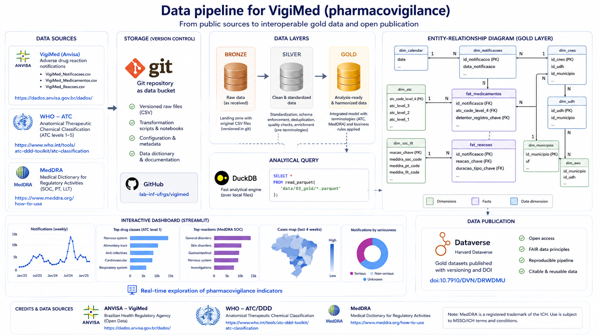
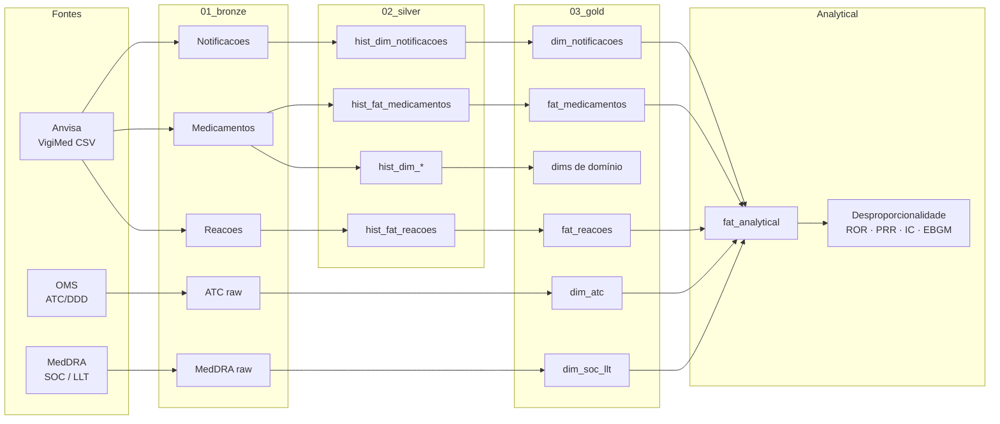

# VigiMed

Projeto para centralizar a ingestão, processamento e análise dos dados do [VigiMed](https://www.gov.br/anvisa/pt-br/assuntos/fiscalizacao-e-monitoramento/notificacoes/vigimed) (Anvisa), enriquecidos com terminologias [ATC](https://www.who.int/tools/atc-ddd-toolkit/atc-classification) (OMS) e [MedDRA](https://www.meddra.org/how-to-use).

**Começar a usar o repositório:** [`docs/start_here.md`](docs/start_here.md)  
**Dicionário / ERD (gold):** [`docs/data_dictionary.md`](docs/data_dictionary.md) · [`docs/erd.md`](docs/erd.md)

A Anvisa publica semanalmente, em [dados abertos](https://dados.anvisa.gov.br/dados/), três CSVs do sistema VigiMed (notificações espontâneas de suspeitas de eventos adversos a medicamentos):

| Arquivo | Conteúdo |
| --- | --- |
| `VigiMed_Notificacoes.csv` | Caso / ICSR (paciente, datas, gravidade, desfecho, notificador) |
| `VigiMed_Medicamentos.csv` | Medicamentos vinculados à notificação (WHO Drug, ATC, dose, via, etc.) |
| `VigiMed_Reacoes.csv` | Reações adversas relatadas (texto / termos associados ao caso) |

Neste repositório esses arquivos entram na camada **bronze** e são transformados até a **gold** (modelo dimensional + terminologias ATC e MedDRA).

## Origem e equipe

A iniciativa nasceu no mestrado da **[Ana Carolina Jacoby](http://lattes.cnpq.br/6000861146264396)** (UFCSPA), sob orientação do prof. **[Sílvio César Cazella](http://lattes.cnpq.br/9173977294178020)**. O trabalho se consolidou em parceria com **[Silmara Gomes Barnabé](http://lattes.cnpq.br/4686076038752039)** (UFRGS) na disciplina da professora **[Carla Maria Dal Sasso Freitas](http://lattes.cnpq.br/4093653182381054)** ([CIARS](https://www.ufrgs.br/ciars/)), com apoio de coordenação da profa. **[Mariana Recamonde-Mendoza](http://lattes.cnpq.br/7829435808451741)** (orientadora da Silmara). **[Mell Amisa Matsuda](http://lattes.cnpq.br/4305262417608808)** integrou o time como bolsista. A profa. **[Carine Raquel Blatt](http://lattes.cnpq.br/4746842392238066)** também integra a equipe do dataset publicado.

## Pipeline ELT

Fluxo Bronze → Silver → Gold, com enriquecimento ATC/MedDRA, publicação no Dataverse e exploração analítica.



Diagrama Mermaid (resumo):



Detalhes de setup, estrutura de pastas e por onde começar: [`docs/start_here.md`](docs/start_here.md).  
ERD completo (todas as colunas): [`docs/erd.md`](docs/erd.md).

## Créditos e fontes de dados

Este projeto depende de dados e terminologias disponibilizados publicamente. Atribuímos crédito às instituições responsáveis:

| Fonte | O que usamos | Link |
| --- | --- | --- |
| **Anvisa — VigiMed** | Notificações espontâneas de suspeitas de eventos adversos a medicamentos no Brasil | [Página VigiMed](https://www.gov.br/anvisa/pt-br/assuntos/fiscalizacao-e-monitoramento/notificacoes/vigimed) · [Dados abertos](https://dados.anvisa.gov.br/dados/) |
| **OMS — ATC/DDD** | Classificação Anatômica Terapêutica Química (níveis 1–5) para agrupamento de medicamentos | [ATC Classification](https://www.who.int/tools/atc-ddd-toolkit/atc-classification) |
| **MedDRA** | Terminologia médica para reações adversas (ex.: SOC, PT, LLT) | [How to use MedDRA](https://www.meddra.org/how-to-use) |

O uso de MedDRA está sujeito aos termos e condições da MSSO/ICH. Consulte a documentação oficial antes de redistribuir ou publicar derivados que incluam a terminologia.

## Dataset Gold (Dataverse) e publicações

A versão **gold** processada deste projeto foi publicada no Harvard Dataverse:

- **Dataset:** [doi:10.7910/DVN/DRWDMU](https://dataverse.harvard.edu/dataset.xhtml?persistentId=doi:10.7910/DVN/DRWDMU)

Esse material já embasou estudos acadêmicos, incluindo:

- a **dissertação** da Ana Carolina Jacoby ([registro / divulgação](https://www.instagram.com/p/DYfmyebyNGN/));
- a **revisão de escopo** sobre métodos de data mining em farmacovigilância, de Ana Carolina Jacoby e Mell Amisa Matsuda (com Carine Raquel Blatt e Sílvio César Cazella): [*Data mining methods, tasks, and algorithms for adverse drug reaction analysis in pharmacovigilance: A scoping review*](https://pubmed.ncbi.nlm.nih.gov/42378892/) (*Int J Med Inform*, 2026; PMID: 42378892; DOI: [10.1016/j.ijmedinf.2026.106554](https://doi.org/10.1016/j.ijmedinf.2026.106554)).

## Licença de uso dos dados

Os dados do VigiMed são publicados pela Anvisa em dados abertos. ATC e MedDRA possuem políticas próprias de uso e redistribuição — consulte os links na seção de créditos antes de republicar conteúdo derivado.

### Como citar

Se usar a versão **gold** publicada no Dataverse, cite (incluindo a versão do dataset):

> Jacoby, Ana Carolina; Barnabé, Silmara; Matsuda, Mell Amisa; Blatt, Carine Raquel; Cazella, Silvio César; Recamonde-Mendoza, Mariana, 2026, "Spontaneous Reporting of Adverse Drug Events in Brazil: VigiMed Dataset (2018–2025)", https://doi.org/10.7910/DVN/DRWDMU, Harvard Dataverse, **V2**.

BibTeX (exemplo):

```bibtex
@data{DVN/DRWDMU_2026,
  author    = {Jacoby, Ana Carolina and Barnab{\'e}, Silmara and Matsuda, Mell Amisa and Blatt, Carine Raquel and Cazella, Silvio C{\'e}sar and Recamonde-Mendoza, Mariana},
  title     = {{Spontaneous Reporting of Adverse Drug Events in Brazil: VigiMed Dataset (2018--2025)}},
  year      = {2026},
  publisher = {Harvard Dataverse},
  version   = {V2},
  doi       = {10.7910/DVN/DRWDMU},
  url       = {https://doi.org/10.7910/DVN/DRWDMU}
}
```
