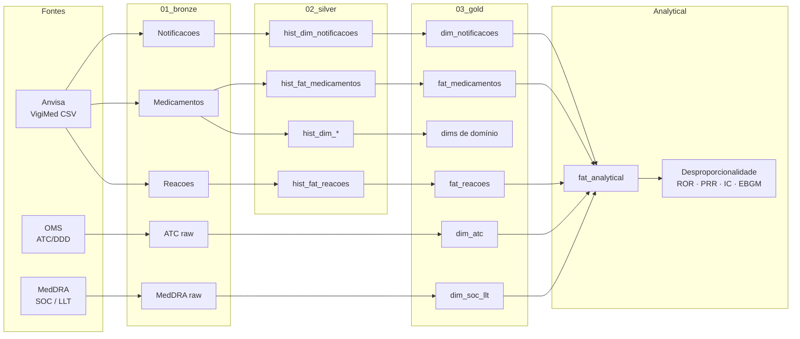

# VigiMed

Projeto para ingestão, processamento e análise dos dados do **VigiMed**, sistema de farmacovigilância da Agência Nacional de Vigilância Sanitária (Anvisa), enriquecidos com as terminologias **ATC** (OMS) e **MedDRA**.

[🇺🇸 English](README.md) | **🇧🇷 Português**

**Começar a usar o repositório:** [`docs/start_here.pt-BR.md`](docs/start_here.pt-BR.md)

**Dicionário de Dados / ERD Gold:** [`docs/data_dictionary.pt-BR.md`](docs/data_dictionary.pt-BR.md) · [`docs/erd.pt-BR.md`](docs/erd.pt-BR.md)

---

A Anvisa publica semanalmente, por meio do Portal Brasileiro de Dados Abertos, três arquivos CSV contendo notificações espontâneas de suspeitas de eventos adversos a medicamentos registradas no sistema VigiMed.

| Arquivo | Conteúdo |
|---------|----------|
| `VigiMed_Notificacoes.csv` | Casos (ICSR): informações do paciente, datas, gravidade, desfecho e notificador. |
| `VigiMed_Medicamentos.csv` | Medicamentos associados à notificação (WHO Drug, classificação ATC, dose, via de administração etc.). |
| `VigiMed_Reacoes.csv` | Reações adversas notificadas associadas a cada caso. |

Neste repositório, esses arquivos são ingeridos na camada **Bronze** e transformados até a camada **Gold**, passando pela camada **Silver**, resultando em um Data Warehouse dimensional enriquecido com as terminologias **ATC** e **MedDRA**.

---

## Origem do projeto

O projeto teve origem no mestrado de **[Ana Carolina Jacoby](http://lattes.cnpq.br/6000861146264396)** na **Universidade Federal de Ciências da Saúde de Porto Alegre (UFCSPA)**, sob orientação do **Prof. [Sílvio César Cazella](http://lattes.cnpq.br/9173977294178020)**.

Posteriormente, foi ampliado e consolidado em parceria com **[Silmara Gomes Barnabé](http://lattes.cnpq.br/4686076038752039)** (Universidade Federal do Rio Grande do Sul – UFRGS), no âmbito da disciplina ministrada pela **Profa. [Carla Maria Dal Sasso Freitas](http://lattes.cnpq.br/4093653182381054)** no **[CIARS](https://www.ufrgs.br/ciars/)**, contando também com o apoio da **Profa. [Mariana Recamonde-Mendoza](http://lattes.cnpq.br/7829435808451741)**, orientadora da Silmara Barnabé.

O dataset publicado é resultado do esforço colaborativo de **[Ana Carolina Jacoby](http://lattes.cnpq.br/6000861146264396)**, **[Silmara Gomes Barnabé](http://lattes.cnpq.br/4686076038752039)**, **[Mell Amisa Matsuda](http://lattes.cnpq.br/4305262417608808)**, **Profa. [Carine Raquel Blatt](http://lattes.cnpq.br/4746842392238066)**, **Prof. [Sílvio César Cazella](http://lattes.cnpq.br/9173977294178020)** e **Profa. [Mariana Recamonde-Mendoza](http://lattes.cnpq.br/7829435808451741)**.

---

## Pipeline ELT

O repositório implementa um pipeline **ELT** baseado na arquitetura **Bronze → Silver → Gold**. Durante o processamento, os dados originais do VigiMed são padronizados, enriquecidos com as terminologias **ATC** e **MedDRA** e transformados em um Data Warehouse dimensional. O conjunto de dados analítico resultante é utilizado em análises de desproporcionalidade e publicado no **Harvard Dataverse**.

**Visão geral (Mermaid):**



Detalhes de setup, estrutura de pastas e por onde começar: [`docs/start_here.md`](docs/start_here.md).  
ERD completo (todas as colunas): [`docs/erd.md`](docs/erd.md).

## Créditos e fontes de dados

Este projeto utiliza dados públicos e terminologias padronizadas. Agradecemos às instituições responsáveis pela disponibilização desses recursos.

| Fonte | Recurso utilizado | Link |
|--------|-------------------|------|
| **Anvisa — VigiMed** | Notificações espontâneas de suspeitas de eventos adversos a medicamentos no Brasil | ... |
| **OMS — ATC/DDD** | Classificação Anatômica Terapêutica Química (ATC), níveis 1–5 | ... |
| **MedDRA** | Terminologia médica padronizada para codificação de reações adversas (SOC, PT, LLT) | ... |

O uso da terminologia **MedDRA** está sujeito aos termos e condições estabelecidos pela **MSSO** e pelo **ICH**. Consulte a documentação oficial antes de redistribuir ou publicar trabalhos derivados que incluam essa terminologia.

---

## Dataset Gold (Harvard Dataverse)

A camada **Gold** produzida por este projeto está disponível publicamente no **Harvard Dataverse**.

**Dataset**

- **Spontaneous Reporting of Adverse Drug Events in Brazil: VigiMed Dataset (2018–2025)**
- DOI: **10.7910/DVN/DRWDMU**
- Harvard Dataverse
- Versão atual: **V2**

---

## Publicações relacionadas

O dataset já deu suporte a diferentes estudos acadêmicos, incluindo:

- a dissertação de mestrado de **Ana Carolina Jacoby**;
- a **revisão de escopo** sobre métodos de data mining em farmacovigilância, de Ana Carolina Jacoby e Mell Amisa Matsuda (com Carine Raquel Blatt e Sílvio César Cazella): [*Data mining methods, tasks, and algorithms for adverse drug reaction analysis in pharmacovigilance: A scoping review*](https://pubmed.ncbi.nlm.nih.gov/42378892/) (*Int J Med Inform*, 2026; PMID: 42378892; DOI: [10.1016/j.ijmedinf.2026.106554](https://doi.org/10.1016/j.ijmedinf.2026.106554)).


---

## Licenciamento dos dados

Os dados do **VigiMed** são publicados pela **Anvisa** por meio do Portal Brasileiro de Dados Abertos.

A classificação **ATC** e a terminologia **MedDRA** possuem políticas próprias de licenciamento e redistribuição.

Consulte a documentação oficial de cada organização antes de redistribuir ou publicar conjuntos de dados derivados que utilizem essas terminologias.

---

### Como citar

Se usar a versão **gold** publicada no Dataverse, cite (incluindo a versão do dataset):

> Jacoby, Ana Carolina; Barnabé, Silmara; Matsuda, Mell Amisa; Blatt, Carine Raquel; Cazella, Silvio César; Recamonde-Mendoza, Mariana, 2026, "Spontaneous Reporting of Adverse Drug Events in Brazil: VigiMed Dataset (2018–2025)", https://doi.org/10.7910/DVN/DRWDMU, Harvard Dataverse, **V2**.

BibTeX (exemplo):

```bibtex
@data{DVN/DRWDMU_2026,
  author    = {Jacoby, Ana Carolina and Barnab{\'e}, Silmara and Matsuda, Mell Amisa and Blatt, Carine Raquel and Cazella, Silvio C{\'e}sar and Recamonde-Mendoza, Mariana},
  title     = {{Spontaneous Reporting of Adverse Drug Events in Brazil: VigiMed Dataset (2018--2025)}},
  year      = {2026},
  publisher = {Harvard Dataverse},
  version   = {V2},
  doi       = {10.7910/DVN/DRWDMU},
  url       = {https://doi.org/10.7910/DVN/DRWDMU}
}
```
