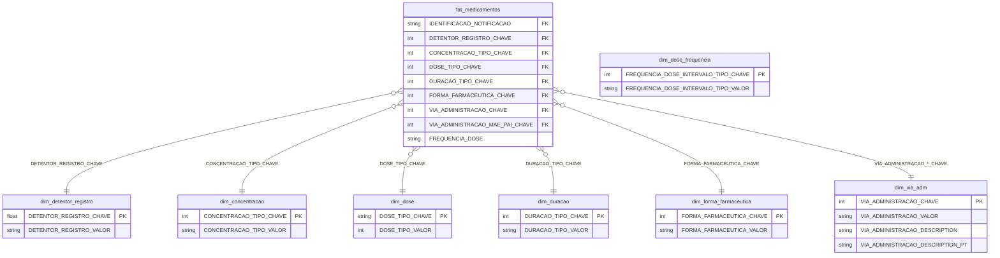
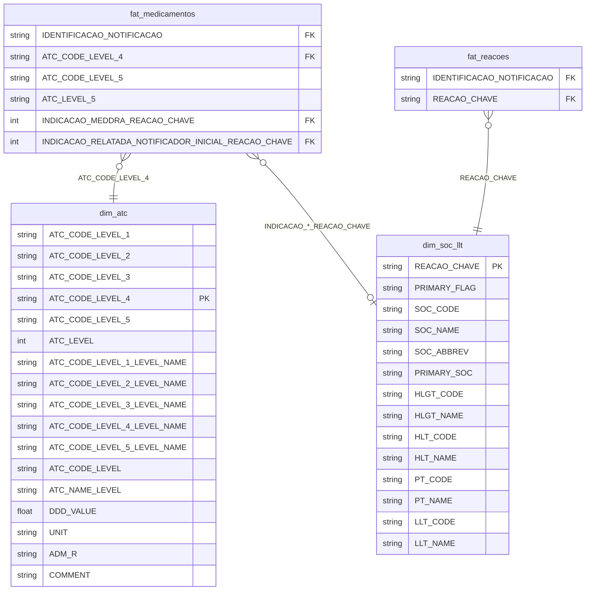

# ERD — Gold layer / Camada gold (VigiMed)

[EN] Fact constellation (also known as a galaxy schema): the ` dim_notificacoes` dimension links the ` fat_medicamentos` and `fat_reacoes` fact tables. ATC, MedDRA, and other domain-specific dimensions enrich the fact tables.

[PT] Esquema em **fact constellation** / estrela: `dim_notificacoes` conecta as facts `fat_medicamentos` e `fat_reacoes`. Dimensões ATC, MedDRA e de domínio enriquecem as facts.

Data Dictionary / Dicionário de dados: [`data_dictionary.md`](data_dictionary.md) · Start here: [`start_here.md`](start_here.md) · draw.io inicial: [abrir](https://viewer.diagrams.net/?tags=%7B%7D&lightbox=1&highlight=0000ff&edit=_blank&layers=1&nav=1&dark=auto#G1z0v-POQDdwkInzBVEe6cLE4_uBEn7GZD#%7B%22pageId%22%3A%221UQrTR_ZhEASL8xhWuEK%22%7D)

##  Pipeline Overview / Pipeline (visão geral)

Consulte a **versão em português** do pipeline [aqui](./pipe_completa.png).

## Relationship Overview / Visão geral (relacionamentos)

```mermaid
erDiagram
    dim_notificacoes ||--o{ fat_medicamentos : "IDENTIFICACAO_NOTIFICACAO"
    dim_notificacoes ||--o{ fat_reacoes : "IDENTIFICACAO_NOTIFICACAO"

    fat_medicamentos }o--|| dim_atc : "ATC_CODE_LEVEL_4"
    fat_medicamentos }o--|| dim_detentor_registro : "DETENTOR_REGISTRO_CHAVE"
    fat_medicamentos }o--|| dim_concentracao : "CONCENTRACAO_TIPO_CHAVE"
    fat_medicamentos }o--|| dim_dose : "DOSE_TIPO_CHAVE"
    fat_medicamentos }o--|| dim_duracao : "DURACAO_TIPO_CHAVE"
    fat_medicamentos }o--|| dim_forma_farmaceutica : "FORMA_FARMACEUTICA_CHAVE"
    fat_medicamentos }o--|| dim_via_adm : "VIA_ADMINISTRACAO_CHAVE"
    fat_medicamentos }o--o| dim_via_adm : "VIA_ADMINISTRACAO_MAE_PAI_CHAVE"
    fat_medicamentos }o--o| dim_soc_llt : "INDICACAO_MEDDRA_REACAO_CHAVE"

    fat_reacoes }o--|| dim_soc_llt : "REACAO_CHAVE"
    fat_reacoes }o--|| dim_duracao : "DURACAO_TIPO_CHAVE"

    dim_notificacoes {
        string IDENTIFICACAO_NOTIFICACAO PK
    }
    fat_medicamentos {
        string IDENTIFICACAO_NOTIFICACAO FK
    }
    fat_reacoes {
        string IDENTIFICACAO_NOTIFICACAO FK
        string REACAO_CHAVE FK
    }
    dim_atc {
        string ATC_CODE_LEVEL_4 PK
    }
    dim_soc_llt {
        string REACAO_CHAVE PK
    }
    dim_detentor_registro {
        float DETENTOR_REGISTRO_CHAVE PK
    }
    dim_concentracao {
        int CONCENTRACAO_TIPO_CHAVE PK
    }
    dim_dose {
        string DOSE_TIPO_CHAVE PK
    }
    dim_dose_frequencia {
        int FREQUENCIA_DOSE_INTERVALO_TIPO_CHAVE PK
    }
    dim_duracao {
        int DURACAO_TIPO_CHAVE PK
    }
    dim_forma_farmaceutica {
        int FORMA_FARMACEUTICA_CHAVE PK
    }
    dim_via_adm {
        int VIA_ADMINISTRACAO_CHAVE PK
    }
```

> `dim_dose_frequencia` existe na gold; em `fat_medicamentos` a frequência atual está em texto (`FREQUENCIA_DOSE`).

> `dim_dose_frequencia` is available in the Gold layer. Currently, the dosing frequency is stored as text in the `fat_medicamentos` fact table, in the (`FREQUENCIA_DOSE`).

## 1. Core entities — notifications, medications, and adverse reactions /  Núcleo — notificação, medicamentos e reações

```mermaid
erDiagram
    dim_notificacoes ||--o{ fat_medicamentos : "1:N"
    dim_notificacoes ||--o{ fat_reacoes : "1:N"

    dim_notificacoes {
        string IDENTIFICACAO_NOTIFICACAO PK
        int UF_CHAVE
        string UF_VALOR
        int TIPO_ENTRADA_VIGIMED_CHAVE
        string TIPO_ENTRADA_VIGIMED_VALOR
        int RECEBIDO_DE_CHAVE
        string RECEBIDO_DE_VALOR
        datetime DATA_INCLUSAO_SISTEMA
        datetime DATA_ULTIMA_ATUALIZACAO
        datetime DATA_NOTIFICACAO
        int TIPO_NOTIFICACAO_CHAVE
        string TIPO_NOTIFICACAO_VALOR
        int NOTIFICACAO_PARENT_CHILD_CHAVE
        string NOTIFICACAO_PARENT_CHILD_VALOR
        datetime DATA_NASCIMENTO
        int IDADE_MOMENTO_REACAO_TIPO_CHAVE
        string IDADE_MOMENTO_REACAO_TIPO_VALOR
        float IDADE_MOMENTO_REACAO_VALOR
        int GRUPO_IDADE_CHAVE
        string GRUPO_IDADE_VALOR
        int IDADE_GESTACIONAL_MOMENTO_REACAO_TIPO_CHAVE
        string IDADE_GESTACIONAL_MOMENTO_REACAO_TIPO_VALOR
        float IDADE_GESTACIONAL_MOMENTO_REACAO_VALOR
        int SEXO_CHAVE
        string SEXO_VALOR
        int GESTANTE_CHAVE
        string GESTANTE_VALOR
        int LACTANTE_CHAVE
        string LACTANTE_VALOR
        string PESO_KG
        string ALTURA_CM
        string REACAO_EVENTO_ADVERSO_MEDDRA
        int GRAVE_CHAVE
        string GRAVE_VALOR
        int GRAVIDADE_CHAVE
        string GRAVIDADE_VALOR
        int DESFECHO_CHAVE
        string DESFECHO_VALOR
        datetime DATA_INICIO_HORA
        datetime DATA_FINAL_HORA
        int DURACAO_TIPO_CHAVE
        string DURACAO_TIPO_VALOR
        float DURACAO_VALOR
        int RELACAO_MEDICAMENTO_EVENTO_CHAVE
        string RELACAO_MEDICAMENTO_EVENTO_VALOR
        string NOME_MEDICAMENTO_WHODRUG
        int ACAO_ADOTADA_CHAVE
        string ACAO_ADOTADA_VALOR
        int NOTIFICADOR_CHAVE
        string NOTIFICADOR_VALOR
        string ATUALIZADO
        string HASH_BRONZE
        string HASH_SILVER
        string HASH_GOLD
    }
    fat_medicamentos {
        string IDENTIFICACAO_NOTIFICACAO FK
        int RELACAO_MEDICAMENTO_EVENTO_CHAVE
        string RELACAO_MEDICAMENTO_EVENTO_VALOR
        string NOME_MEDICAMENTO_WHODRUG
        string PRINCIPIOS_ATIVOS_WHODRUG
        string ATC_CODE_LEVEL_4 FK
        string ATC_CODE_LEVEL_5
        string ATC_LEVEL_5
        float ATC_LEVEL_5_SCORE
        string DETENTOR_REGISTRO
        float DETENTOR_REGISTRO_SCORE
        int DETENTOR_REGISTRO_CHAVE FK
        int CONCENTRACAO_TIPO_CHAVE FK
        string CONCENTRACAO_TIPO_VALOR
        float CONCENTRACAO_VALOR
        float CONCENTRACAO_VALOR_NUMERADOR
        float CONCENTRACAO_VALOR_DENOMINADOR
        int COMPONENTE_SUSPEITO_CHAVE
        string COMPONENTE_SUSPEITO_VALOR
        int ACAO_ADOTADA_CHAVE
        string ACAO_ADOTADA_VALOR
        int PROB_ADIC_ABUSO
        int PROB_ADIC_ERRO_DE_MEDICACAO
        int PROB_ADIC_EXPOSICAO_OCUPACIONAL
        int PROB_ADIC_FALSIFICACAO
        int PROB_ADIC_LOTES_TESTADOS_E_DENTRO_DAS_ESPECIFICACOES
        int PROB_ADIC_LOTES_TESTADOS_E_FORA_DAS_ESPECIFICACOES
        int PROB_ADIC_MEDICAMENTO_TOMADO_FORA_DA_DATA_DE_VALIDADE
        int PROB_ADIC_MEDICAMENTO_TOMADO_PELO_PAI
        int PROB_ADIC_SUPERDOSE
        int PROB_ADIC_USO_INCORRETO
        int PROB_ADIC_USO_OFF_LABEL_USO_SEM_REGISTRO
        int INDICACAO_MEDDRA_REACAO_CHAVE FK
        int INDICACAO_RELATADA_NOTIFICADOR_INICIAL_REACAO_CHAVE FK
        int DOSE_TIPO_CHAVE FK
        string DOSE_TIPO_VALOR
        float DOSE_VALOR
        string FREQUENCIA_DOSE
        string POSOLOGIA
        int DURACAO_TIPO_CHAVE FK
        string DURACAO_TIPO_VALOR
        float DURACAO_VALOR
        datetime INICIO_ADMINISTRACAO
        datetime FIM_ADMINISTRACAO
        int FORMA_FARMACEUTICA_CHAVE FK
        int VIA_ADMINISTRACAO_CHAVE FK
        int VIA_ADMINISTRACAO_MAE_PAI_CHAVE FK
        string NUMELO_LOTE
        string ATUALIZADO
        string HASH_BRONZE
        string HASH_SILVER
        string HASH_GOLD
    }
    fat_reacoes {
        string IDENTIFICACAO_NOTIFICACAO FK
        datetime DATA_INICIO_HORA
        datetime DATA_FINAL_HORA
        string REACAO_CHAVE FK
        int GRAVE_CHAVE
        string GRAVE_VALOR
        int DESFECHO_CHAVE
        string DESFECHO_VALOR
        int DURACAO_TIPO_CHAVE FK
        string DURACAO_TIPO_VALOR
        float DURACAO_VALOR
        int GRAVIDADE_RESULTADO_OBITO
        int GRAVIDADE_AMEACA_VIDA
        int GRAVIDADE_INCAPACIDADE
        int GRAVIDADE_HOSPITALIZACAO
        int GRAVIDADE_OUTRO_EFEITO
        int GRAVIDADE_ANOMALIA_CONGENITA
        string ATUALIZADO
        string HASH_BRONZE
        string HASH_SILVER
        string HASH_GOLD
    }
```

## 2. Medication domain dimensions / Dimensões de medicamento (domínio)

## 3. Standard terminologies — ATC and MedDRA / Terminologias — ATC e MedDRA

